<div align="center">

# Clinical RAG

### An Evidence-Based Clinical AI Assistant for Healthcare Professionals Using Medical Large Language Models and Retrieval-Augmented Generation


**Source-grounded medication information from official FDA DailyMed labels, with hybrid retrieval, a deterministic evidence gate and exact-quote validation.**

</div>

> **Important:** This is an academic project for source-based medication-information lookup. It has **not** undergone clinical validation, clinical safety testing or healthcare-professional validation. Verify all information against the official label before professional use. Do not enter patient identifiers.

The prototype uses the general-purpose openai/gpt-oss-120b model through Groq within a medical-information RAG workflow.

---

## Table of Contents

1. [What This Project Does](#what-this-project-does)
2. [Quick Facts](#quick-facts)
3. [How It Works](#how-it-works)
4. [The 2×2 Experiment](#the-22-experiment)
5. [Results](#results)
6. [Error Analysis](#error-analysis)
7. [Data Provenance](#data-provenance)
8. [Tech Stack](#tech-stack)
9. [Repository Structure](#repository-structure)
10. [Quickstart](#quickstart)
11. [Running the Benchmarks](#running-the-benchmarks)
12. [Database Schema](#database-schema)
13. [Testing](#testing)
14. [Scope and Exclusions](#scope-and-exclusions)
15. [Known Limitations](#known-limitations)
16. [Future Work](#future-work)
17. [Reproducibility](#reproducibility)
18. [Disclaimer](#disclaimer)

---

## What This Project Does

General-purpose language models can produce plausible but unsupported medical statements and rarely point to the exact source text. Clinical RAG answers questions **only** from an official FDA DailyMed drug label and shows the evidence behind every answer.

For each question, the system:

- rejects out-of-scope requests (diagnosis, patient-specific dosing, emergency triage) locally, without any LLM call
- resolves which drug the question is about and asks for clarification when it is ambiguous
- retrieves the most relevant label passages using dense retrieval or hybrid BM25 + dense retrieval
- optionally runs a **local deterministic evidence gate** that abstains before generation when evidence is insufficient
- generates a structured answer with Groq and checks that every quote is **character-exact** and contiguous in the retrieved passage
- returns the answer with quotes, passage IDs and source metadata, or an honest abstention

---

## Quick Facts

| Item | Value |
|:---|:---|
| Source data | FDA DailyMed SPL XML (real label, not synthetic) |
| Corpus | Label `L001`: metformin hydrochloride, 11 passages |
| Generator | `openai/gpt-oss-120b` through Groq (general-purpose model) |
| Embeddings | `all-MiniLM-L6-v2` (ONNX, 384 dimensions) in persistent ChromaDB |
| Sparse retrieval | Custom BM25Okapi (k1 = 1.5, b = 0.75) |
| Fusion | Reciprocal Rank Fusion, k = 60 |
| Variants compared | A, B, C, D (2×2 design) |
| Development benchmark | 20 questions (frozen) |
| Held-out benchmark | 40 questions (frozen, Variant A run only) |
| Automated tests | 89 passing, zero Groq calls |
| Interfaces | FastAPI (`/health`, `/sources`, `/ask`) and Streamlit UI |

---

## How It Works

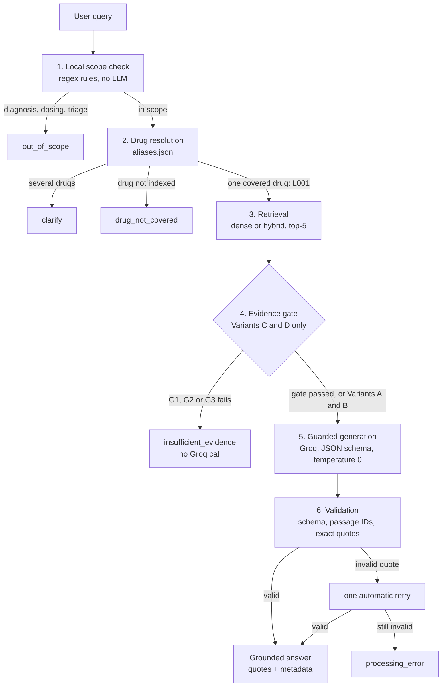

### Hybrid retrieval (Variants B and D)

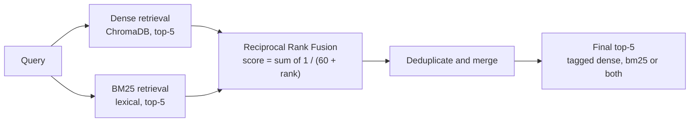

### Evidence gate (Variants C and D)

The gate is a local, rule-based check. It is **not** an LLM and **not** a medical safety classifier.

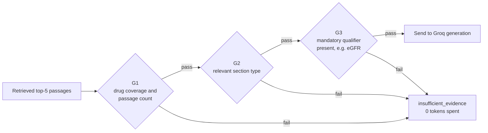

### Response statuses

| Status | Meaning |
|:---|:---|
| `answer` | Evidence found and a validated, quoted answer returned |
| `clarify` | The question is ambiguous (for example several drugs) |
| `insufficient_evidence` | A covered drug, but no explicit supporting evidence |
| `out_of_scope` | Diagnosis, individual dosing or emergency triage request |
| `drug_not_covered` | The drug is not in the indexed corpus |
| `processing_error` | Provider failure or quote validation failed after retry |

---

## The 2×2 Experiment

Only two things change between variants: the retrieval method and whether the evidence gate is used. Corpus, model, prompt and generation settings are identical.

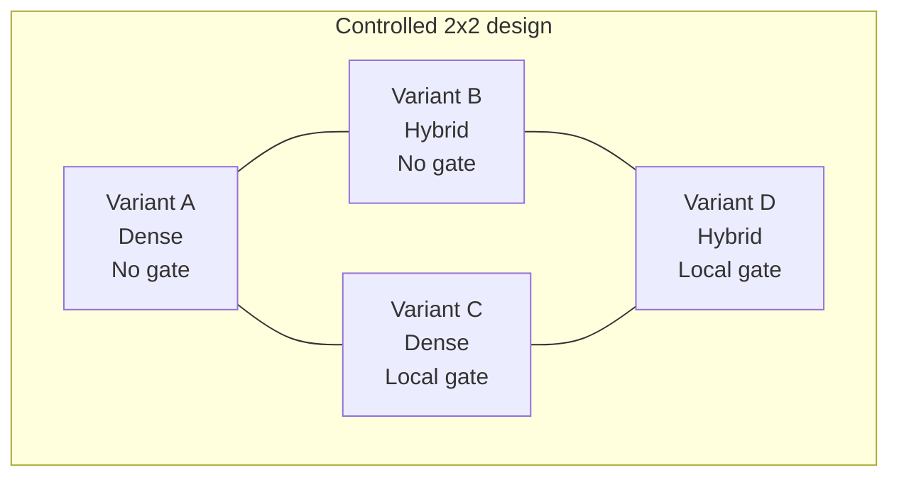

| | No evidence gate | Local deterministic gate |
|:---|:---:|:---:|
| **Dense retrieval (ChromaDB)** | Variant A | Variant C |
| **Hybrid retrieval (Dense + BM25 + RRF)** | Variant B | Variant D |

### Benchmarks

| Split | Questions | Answerable | Insufficient evidence | Clarification | Out of scope | Incorrect premise |
|:---|:---:|:---:|:---:|:---:|:---:|:---:|
| Development (frozen) | 20 | 10 | 4 | 3 | 3 | - |
| Held-out (frozen) | 40 | 20 | 8 | 5 | 4 | 3 |

Due to provider-side daily token-quota constraints, held-out evaluation was completed for **Variant A only**. Held-out results are therefore preliminary and are **not** used for cross-variant comparison. The primary four-variant comparison uses the frozen 20-question development benchmark.

---

## Results

### Development benchmark (20 questions, four variants)

| Metric | A: Dense | B: Hybrid | C: Dense + Gate | D: Hybrid + Gate |
|:---|:---:|:---:|:---:|:---:|
| Run ID | `run_A_f4abde8f0bf9` | `run_B_e87bda7469d5` | `run_C_641db18ad808` | `run_D_6e9b602d7417` |
| Status match | 17/20 (85.0%) | 19/20 (95.0%) | 17/20 (85.0%) | 18/20 (90.0%) |
| Evidence hit@5 | 8/10 (80.0%) | 10/10 (100.0%) | 8/10 (80.0%) | 10/10 (100.0%) |
| Required-evidence coverage | 8/10 (80.0%) | 10/10 (100.0%) | 8/10 (80.0%) | 10/10 (100.0%) |
| Answerable answered | 8/10 (80.0%) | 10/10 (100.0%) | 8/10 (80.0%) | 9/10 (90.0%) |
| Appropriate abstention | 4/4 | 4/4 | 4/4 | 4/4 |
| Appropriate clarification | 2/3 (66.7%) | 2/3 (66.7%) | 2/3 (66.7%) | 2/3 (66.7%) |
| Appropriate scope refusal | 3/3 | 3/3 | 3/3 | 3/3 |
| Over-refusal | 2/10 (20.0%) | 0/10 (0.0%) | 2/10 (20.0%) | 1/10 (10.0%) |
| Processing errors | 0 | 0 | 0 | 1 (see note) |
| Mean latency | 5.420 s | 8.004 s | 3.985 s | 6.978 s |
| Median (p50) latency | 1.933 s | 7.976 s | 1.036 s | 1.840 s |
| p95 latency | 19.313 s | 17.977 s | 14.771 s | 19.800 s |
| Total tokens | 32,833 | 37,385 | 28,618 | 32,681 |
| Mean tokens per question | 1,641.7 | 1,869.2 | 1,430.9 | 1,634.0 |
| Groq generation calls | 16 | 16 | 14 | 14 |
| Gate-avoided calls | 0 | 0 | 2 | 0 |

**Notes**

- The Variant D processing error (DEV-Q005) came from the model stitching non-contiguous bullet lines into one quote, which exact validation rejected. Stricter contiguous-quote prompt rules and one automatic retry were added afterwards. The table shows the **original** run.
- Efficiency changes compare C against A (tokens -12.8%, mean latency -26.5%) and D against B (tokens -12.6%, mean latency -12.8%). The baselines differ.
- Latency is descriptive only. BM25 and fusion run locally, and latency is affected by cache hits, local abstentions and answer length.

### What the results show

- **Hybrid retrieval improved evidence retrieval.** Variants B and D reached 100% evidence hit@5, against 80% for A and C, on this development set.
- **Hybrid retrieval reduced over-refusal** (B: 0%, D: 10%, A and C: 20%).
- **The gate reduced LLM usage in the dense configuration.** Variant C made 14 generation calls instead of 16 and used 12.8% fewer tokens than A.
- **Abstention and scope refusal were 100% for all four variants** on the development set (4/4 and 3/3).
- **Clarification was the weakest behaviour** at 2/3 for every variant (see DEV-Q016 below).
- The benchmark is small, so the results are descriptive and no statistical significance is claimed.

### Held-out benchmark (Variant A only, preliminary)

| Metric | Variant A |
|:---|:---:|
| Run ID | `run_A_29dae73de52f` |
| Questions evaluated | 40 |
| Status match | 32/40 (80.0%) |
| Processing errors | 0/40 |
| Appropriate abstention | 8/8 |
| Appropriate scope refusal | 4/4 |
| Mean latency | 9.07 s |
| Median (p50) latency | 6.96 s |
| p95 latency | 21.03 s |
| Total tokens | 64,174 |
| Groq calls | 33 |

Do not compare this row with the development results of Variants B, C or D.

### Figures

All figures are generated with Matplotlib from stored evaluation records and are available as PNG (300 DPI) and vector PDF in [`data/results/figures/`](data/results/figures/).

| | |
|:---:|:---:|
| 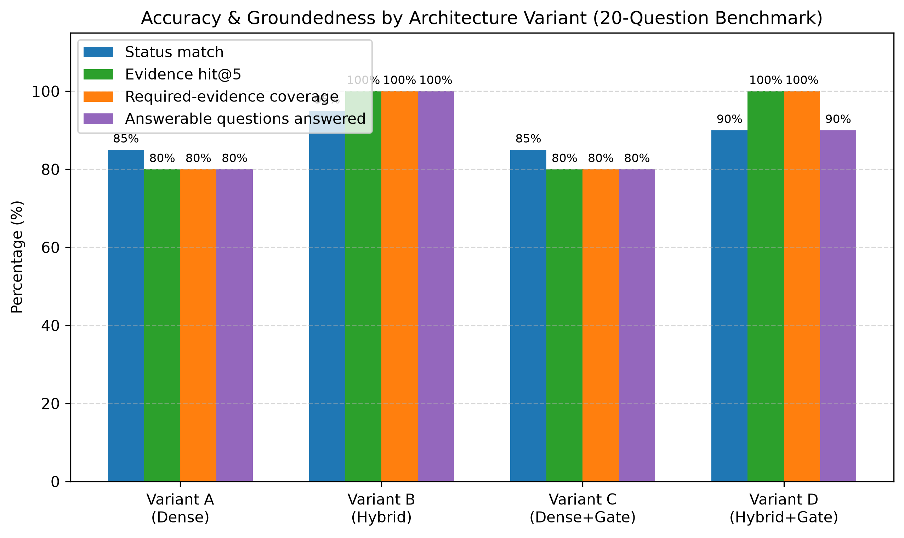 | 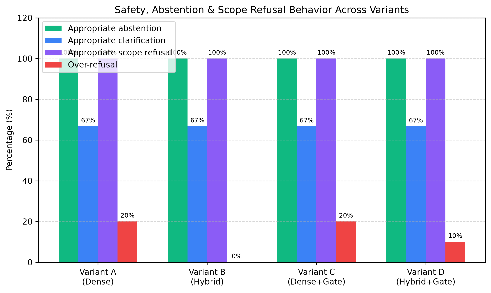 |
| **Accuracy comparison** | **Safety behaviour** |
| 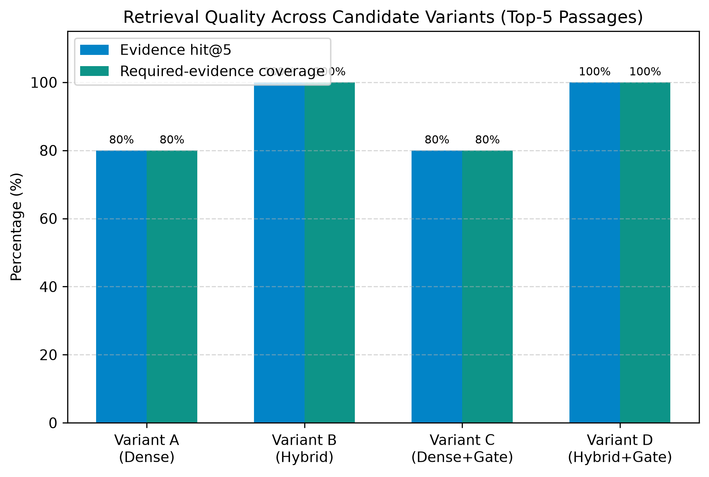 | 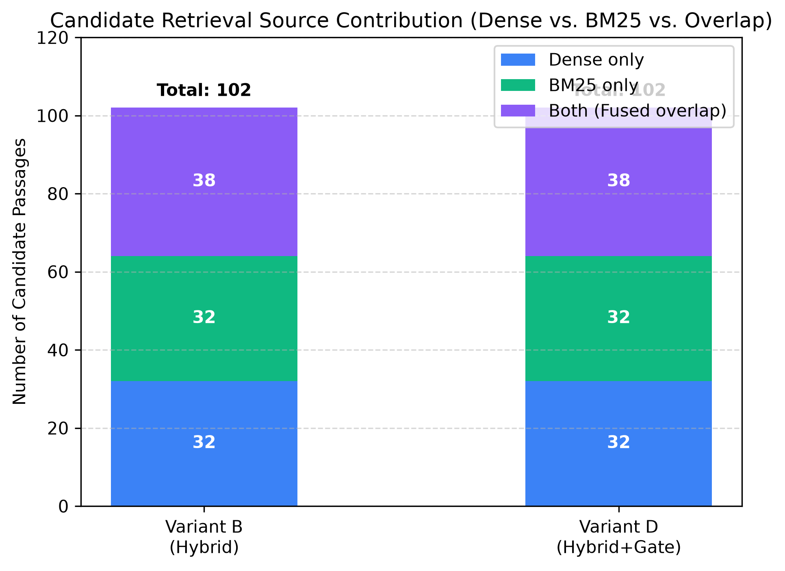 |
| **Retrieval quality** | **Retrieval source contribution (B and D)** |
| 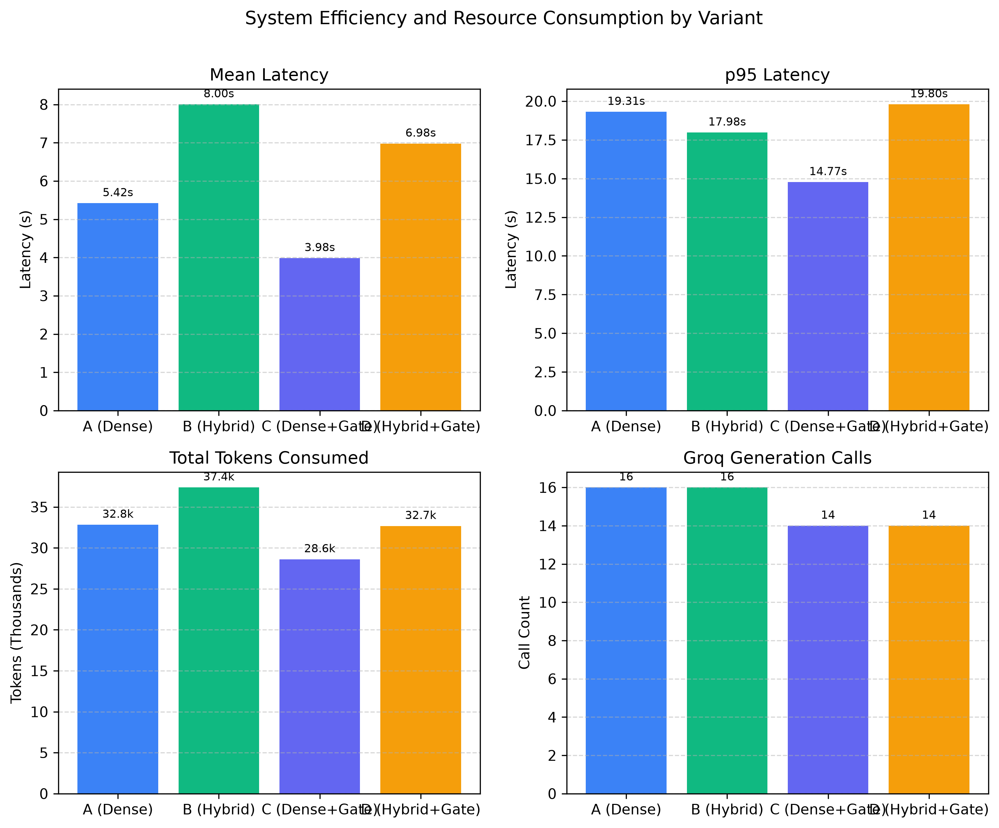 | 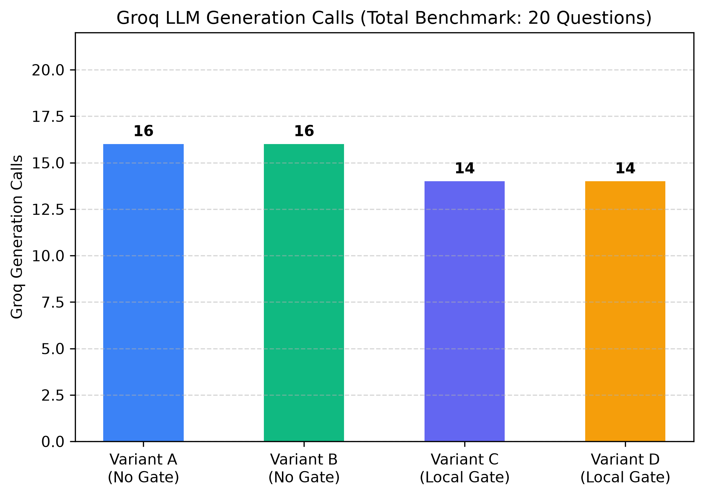 |
| **Efficiency comparison** | **Groq call avoidance by the gate** |
| 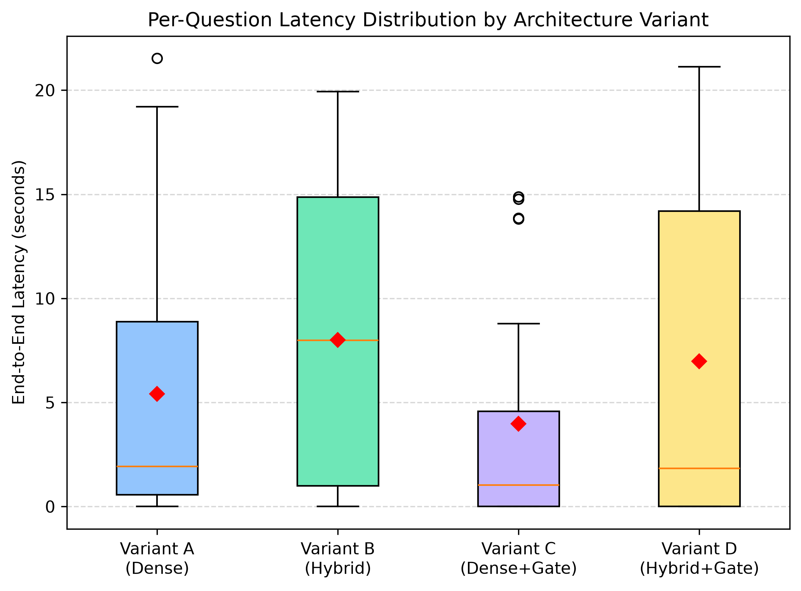 | 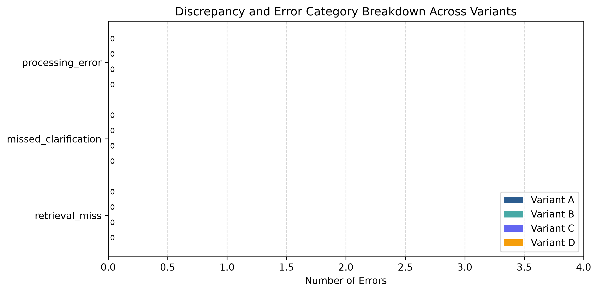 |
| **Latency distribution** | **Error analysis by variant** |

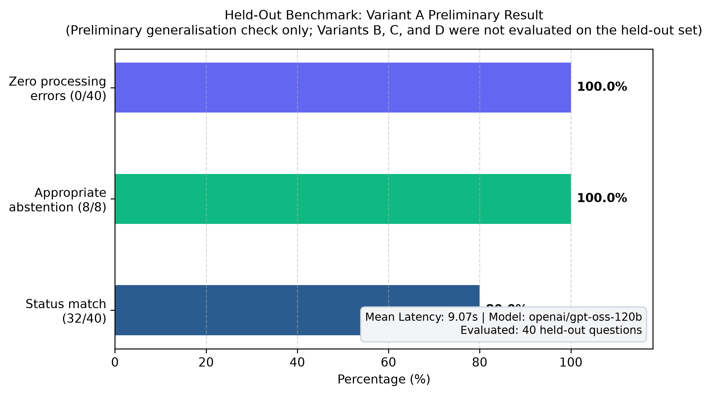

**Held-out Variant A preliminary result**

### Result tables (CSV and Markdown)

| File | Contents |
|:---|:---|
| [`final_development_comparison.csv`](data/results/final_development_comparison.csv) | Final four-variant development comparison |
| [`summary_comparison_all.csv`](data/results/summary_comparison_all.csv) | Four-way summary table |
| [`final_error_analysis.csv`](data/results/final_error_analysis.csv) | Final discrepancy list across all runs |
| [`error_analysis_all.csv`](data/results/error_analysis_all.csv) | Complete four-variant error table |
| [`heldout_variant_a_preliminary.csv`](data/results/heldout_variant_a_preliminary.csv) | Held-out Variant A results |
| [`paper_tables.md`](data/results/paper_tables.md) | Formatted tables for the paper |
| [`paper_findings.md`](data/results/paper_findings.md) | Findings and operational disclaimers |

---

## Error Analysis

Across the 20 development questions, 9 discrepancies occurred across the four variants.

| Variant | Question | Expected | Actual | Category | Explanation |
|:---:|:---:|:---:|:---:|:---:|:---|
| A | DEV-Q006 | answer | insufficient_evidence | retrieval_miss | Dense retrieval ranked the Section 5.1 iodinated-contrast passage at rank 6, outside the top 5 |
| A | DEV-Q010 | answer | insufficient_evidence | retrieval_miss | Dense retrieval missed the MELAS/mitochondrial passage `L001-5.1-p03` |
| A | DEV-Q016 | clarify | insufficient_evidence | missed_clarification | Multi-drug question ("metformin and lisinopril") handled as a single metformin match |
| B | DEV-Q016 | clarify | insufficient_evidence | missed_clarification | Same multi-drug routing behaviour |
| C | DEV-Q006 | answer | insufficient_evidence | retrieval_miss | Dense retrieval missed the passage; the local gate detected the missing qualifier and abstained without an LLM call |
| C | DEV-Q010 | answer | insufficient_evidence | retrieval_miss | Dense retrieval missed the MELAS passage; the gate abstained locally |
| C | DEV-Q016 | clarify | insufficient_evidence | missed_clarification | Same multi-drug routing behaviour |
| D | DEV-Q005 | answer | processing_error | processing_error | Model stitched non-contiguous bullet lines in a quote; exact validation rejected the response |
| D | DEV-Q016 | clarify | insufficient_evidence | missed_clarification | Same multi-drug routing behaviour |

**Reading the table**

- The two dense-only retrieval misses (DEV-Q006, DEV-Q010) were recovered by hybrid retrieval, because BM25 matched exact terms such as "iodinated contrast" and "MELAS".
- DEV-Q016 failed in every variant. It is a drug-resolver limitation, not a retrieval or gate problem.
- DEV-Q005 shows the quote validator doing its job: it rejects a bad quote instead of silently repairing it.

---

## Data Provenance

| Label ID | Drug | Official product title | SPL version | Effective date | Source |
|:---:|:---|:---|:---:|:---:|:---|
| `L001` | metformin hydrochloride | METFORMIN HYDROCHLORIDE TABLET [REMEDYREPACK INC.] | 22 | 20261026 | DailyMed SPL XML |

- FDA Set ID: `30658e19-8e6e-49aa-a007-e414224797c5`
- Document ID: `30658e19-8e6e-49aa-a007-e414224797c5_v22`
- Raw source kept for provenance: `data/raw/30658e19-8e6e-49aa-a007-e414224797c5_v22.xml` (SHA-256 recorded in `data/manifest/documents.json`)
- Corpus: 11 passages in `data/passages/L001.jsonl`. Passage IDs are immutable across the vector store, the SQL database, benchmark gold answers and generated quotes.

| Passage ID | Section | Content |
|:---|:---:|:---|
| `L001-2.3-p01` | 2.3 | Dosage: recommendations for renal impairment |
| `L001-4-p01` | 4 | Contraindications |
| `L001-5.1-p01` | 5.1 | Lactic acidosis: clinical features and hemodialysis |
| `L001-5.1-p02` | 5.1 | Lactic acidosis: renal monitoring, age 65+, contrast imaging |
| `L001-5.1-p03` | 5.1 | Lactic acidosis: surgery, hypoxia, alcohol, hepatic, mitochondrial disease |
| `L001-5.2-p01` | 5.2 | Vitamin B12 deficiency |
| `L001-5.3-p01` | 5.3 | Hypoglycemia with insulin or secretagogues |
| `L001-5.4-p01` | 5.4 | Macrovascular outcomes |
| `L001-7-p01` | 7 | Drug interactions: table lead-in |
| `L001-7-p02` | 7 | Drug interactions: clinically significant interactions |
| `L001-8.6-p01` | 8.6 | Use in specific populations: renal impairment |

---

## Tech Stack

| Layer | Technology |
|:---|:---|
| Language | Python 3.11 |
| Backend API | FastAPI, Pydantic v2 |
| Frontend | Streamlit |
| Relational database | SQLite with SQLModel |
| Vector store | ChromaDB (persistent, cosine distance) |
| Dense embeddings | all-MiniLM-L6-v2 (ONNX, 384 dimensions) |
| Sparse retrieval | Custom BM25Okapi with a medical tokenizer and stopword filter |
| Fusion | Reciprocal Rank Fusion (k = 60) |
| LLM | `openai/gpt-oss-120b` through Groq (JSON-schema structured output, temperature 0.0, max tokens 2048, low reasoning effort) |
| Visualisation | Matplotlib |
| Testing | pytest |

---

## Repository Structure

```text
clinical-rag/
├── .env.example                 # Template for environment variables
├── .gitignore                   # Excludes venv, chroma_db, app.db, caches
├── pytest.ini                   # Pytest configuration
├── requirements.txt             # Pinned dependencies
├── PROJECT_STATE.md             # Project lifecycle and milestone log
├── README.md
│
├── app/                         # Application core
│   ├── api.py                   # FastAPI endpoints (/health, /sources, /ask)
│   ├── config.py                # Settings loaded from .env
│   ├── db.py                    # SQLite engine and sessions
│   ├── main.py                  # FastAPI entrypoint
│   ├── models.py                # SQLModel table schemas
│   ├── schemas.py               # Pydantic request/response models
│   └── services/
│       ├── scope.py             # Local scope classifier and drug alias resolver
│       ├── retrieval.py         # ChromaDB dense, BM25 and RRF fusion
│       ├── evidence.py          # Deterministic evidence gate (G1, G2, G3)
│       ├── generation.py        # Groq client, JSON schema and prompt rules
│       ├── qa.py                # Pipeline coordinator and quote validator
│       ├── evaluation.py        # Benchmark runner, run hashing, caching
│       ├── metrics.py           # Hit@5, coverage and other metrics
│       ├── review.py            # Export for manual judgment CSVs
│       └── visualisation.py     # Matplotlib figure generation
│
├── data/
│   ├── benchmark/               # dev_questions.jsonl (20), heldout_questions.jsonl (40)
│   ├── manifest/                # aliases.json, curation.json, documents.json
│   ├── passages/                # L001.jsonl and review_L001.md
│   ├── raw/                     # Immutable DailyMed XML
│   └── results/                 # CSV and Markdown result tables
│       └── figures/             # 9 figures, PNG (300 DPI) and PDF
│
├── scripts/                     # Command-line tools
│   ├── fetch_label.py           # Download a DailyMed SPL XML by set ID
│   ├── extract_passages.py      # Parse XML into curated passages
│   ├── ingest.py                # Index passages into ChromaDB
│   ├── init_db.py               # Create SQLite tables and register manifests
│   ├── ask.py                   # Interactive terminal queries
│   ├── evaluate.py              # Benchmark runner (--variant, --benchmark, --limit)
│   ├── summarise_results.py     # Aggregate results into tables
│   └── generate_figures.py      # Export publication figures
│
├── tests/                       # 89 tests, zero Groq calls
└── ui/
    └── streamlit_app.py         # Streamlit interface
```

`chroma_db/` and `data/app.db` are generated locally and excluded from version control.

---

## Quickstart

### 1. Clone and install

```bash
git clone https://github.com/<your-username>/clinical-rag.git
cd clinical-rag

python -m venv venv
.\venv\Scripts\Activate.ps1        # Windows PowerShell
# source venv/bin/activate         # macOS / Linux

pip install -r requirements.txt
```

### 2. Configure the environment

Copy `.env.example` to `.env` and add your Groq API key:

```env
GROQ_API_KEY=your_groq_api_key_here
GROQ_MODEL=openai/gpt-oss-120b
GROQ_TEMPERATURE=0.0
GROQ_MAX_TOKENS=2048
PROMPT_VERSION=v1
RETRIEVAL_TOP_K=5
```

Never commit your `.env` file.

### 3. Build the database and vector index

```bash
python scripts/init_db.py      # creates the SQLite tables
python scripts/ingest.py       # indexes the L001 passages into ChromaDB
```

### 4. Run the application

```bash
# Backend API
uvicorn app.main:app --host 127.0.0.1 --port 8000 --reload

# Streamlit interface (new terminal)
streamlit run ui/streamlit_app.py
```

Or try the terminal interface:

```bash
python scripts/ask.py
```

### API endpoints

| Method | Endpoint | Purpose |
|:---:|:---|:---|
| GET | `/health` | Service health check |
| GET | `/sources` | Indexed label sources and metadata |
| POST | `/ask` | Ask a question and receive a structured, validated response |

Interactive clinician queries are **not** stored in the database.

---

## Running the Benchmarks

```bash
# Development benchmark, 20 questions
python scripts/evaluate.py --variant A
python scripts/evaluate.py --variant B
python scripts/evaluate.py --variant C
python scripts/evaluate.py --variant D

# Held-out benchmark, 40 questions (Variant A only in this project)
python scripts/evaluate.py --variant A --benchmark heldout

# Aggregate results and regenerate figures
python scripts/summarise_results.py
python scripts/generate_figures.py
```

Groq responses are cached in SQLite, so completed questions can be replayed without new API calls. Evaluation runs spend Groq tokens, so check your provider's daily quota first.

---

## Database Schema

SQLite database `data/app.db`, built with SQLModel.

| Table | Purpose |
|:---|:---|
| `documents` | SPL metadata: document ID, set ID, SPL version, effective date, title, source hash |
| `passages` | The 11 authoritative passages with section type, title, word count and text |
| `benchmark_questions` | Frozen questions with category, expected action, gold passage IDs and split |
| `runs` | One row per benchmark run: variant, model, prompt version, corpus hash, benchmark hash, config |
| `results` | Per-question status, answer, retrieved IDs, latency, token counts and errors |
| `judgments` | Manual review records linked to results |
| `llm_cache` | Cached Groq responses keyed by SHA-256 of model, prompt version, variant, question ID, passage IDs and settings |

Run IDs are deterministic: `run_<variant>_<first 12 characters of SHA-256 over variant, model, prompt version, corpus hash and config>`.

---

## Testing

```bash
pytest -v
```

89 tests pass in about 20 seconds and make **no Groq API calls**.

| Test file | Covers |
|:---|:---|
| `test_api.py` | HTTP endpoints, status codes, validation |
| `test_db.py` | SQLite CRUD, schemas, caching |
| `test_evaluation.py` | Evaluation runner, resumption, hashing |
| `test_evidence.py` | Gate rules G1, G2, G3 |
| `test_metrics.py` | Hit@5, coverage, over-refusal calculations |
| `test_milestone4.py` | Held-out dataset schema, categories, passage IDs |
| `test_qa.py` | End-to-end pipeline and error handling |
| `test_retrieval.py` | ChromaDB, BM25 and RRF |
| `test_review.py` | Manual judgment export |
| `test_scope.py` | Scope filters and drug name normalisation |
| `test_validation.py` | Response schema and exact quote checks |
| `test_visualisation.py` | Figure generation without Groq calls |

---

## Scope and Exclusions

**In scope:** label-grounded questions about contraindications, warnings and precautions, drug interactions, and dosage guidance for indexed drugs (currently metformin hydrochloride, `L001`).

**Out of scope:**

- individual patient diagnosis
- patient-specific dose calculation or prescribing
- emergency bedside triage
- drugs without an indexed DailyMed label
- EHR integration, live web retrieval and fine-tuning

---

## Known Limitations

- **Small benchmarks.** 20 development and 40 held-out questions. Differences between variants are one or two questions, so results are descriptive and no statistical significance is claimed.
- **Held-out coverage.** Only Variant A was run on the held-out set because of provider-side daily token-quota limits.
- **Single label.** The corpus is one metformin label with 11 passages. With so few passages, the top-5 retrieval covers a large part of the corpus.
- **Clarification.** The drug resolver does not detect an unindexed second drug (DEV-Q016).
- **Rule-based gate.** The gate cannot capture every form of insufficient evidence.
- **Latency.** Reported latency is affected by cache hits, local abstentions and answer length.
- **External dependency.** Generation depends on a third-party provider's availability, latency and quotas.
- **Not clinically validated.** No clinician evaluation or real-world deployment testing was performed.
- **General-purpose model.** The generator is a general-purpose model, not a medical model.

---

## Future Work

- Expand the corpus to multiple drugs and therapeutic areas
- Complete held-out evaluation for Variants B, C and D
- Grow the benchmark with more ambiguous and adversarial questions
- Detect multi-drug and comparative questions for clarification
- Add reranking, query expansion and section-aware retrieval
- Evaluate clinician usability through an ethics-approved user study
- Investigate local open-weight models for privacy-preserving deployment
- Add monitoring, audit logs and versioned knowledge-base updates

---

## Reproducibility

- All evaluation results are stored in SQLite and exported as CSV and Markdown.
- Run IDs and cache keys are deterministic hashes of the run configuration.
- The corpus is hash-verified against the original DailyMed XML.
- Figures are generated with Matplotlib from stored evaluation records.
- The test suite makes no external API calls.

---

## Disclaimer

This system is an academic project for source-grounded retrieval from DailyMed product inserts. It has not undergone clinical validation, clinical safety testing or healthcare-professional validation. It must not be used for medical diagnosis, individualised dosing or patient management. No claims of superiority over commercial systems, human practitioners or alternative LLM architectures are made.

---

## License

Released under the MIT License. See [`LICENSE`](LICENSE).

---

## Author

<div align="center">

**Made by Harman Saini**

Owner and maintainer of this repository

[](mailto:harmanajitsinghsaini16@gmail.com)
[](https://github.com/<your-username>)

*Questions, feedback and collaboration ideas are welcome. Open an issue or send an email.*

</div>
